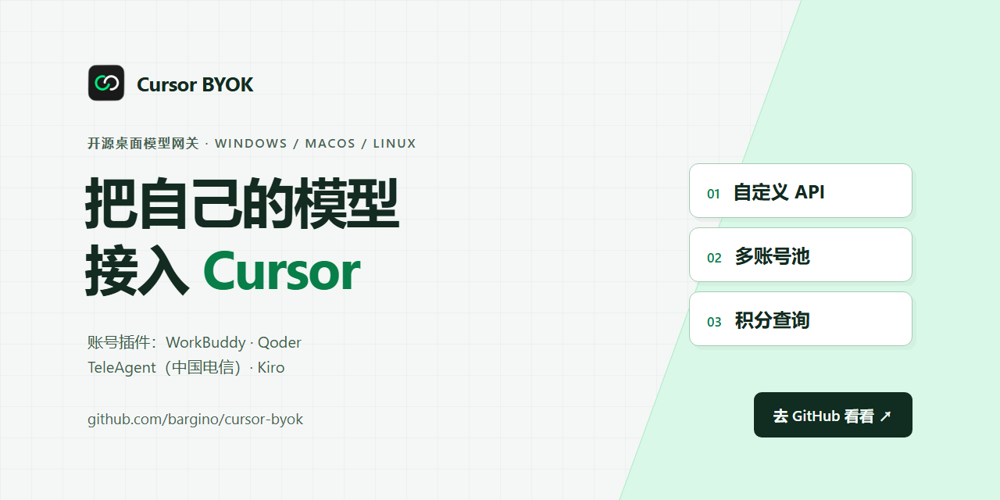

# 中文社区介绍草稿

适合在允许作品展示的中文社区，结合本人使用体验修改后发布。不要将本文自动投到要求本人原创或禁止 AI 文案的平台。

标题：**继续维护 Cursor BYOK：把自己的模型 API、WorkBuddy / Qoder 等账号接入 Cursor**

---

如果你在几个模型服务之间切换，希望在 Cursor 中使用自己的 API，或集中管理已有账号的模型连接，可以看看我在维护的 Cursor BYOK 社区 fork：

[github.com/bargino/cursor-byok](https://github.com/bargino/cursor-byok)

它是一个运行在本机的开源桌面模型网关。配置自己的 OpenAI / Anthropic 兼容接口后，在 Cursor 中选择对应模型，使用 Agent 对话和工具调用；在桌面应用里可以查看调用记录、Token 用量和缓存统计。

这次维护主要补了几个与日常使用有关的功能：

- **账号接入**：1.0.4 构建加入 WorkBuddy、Qoder 国内/国际、TeleAgent（中国电信）和 Kiro 插件，按各服务的授权方式登录或导入凭据，同步模型目录并查询积分。
- **多账号池**：一个服务可以保存多个账号，轮转可用账号；修复并发登录、刷新时旧账号列表覆盖新账号的问题，也补了 Codex、Google Antigravity 和 Grok 的身份测试。
- **Cursor 协议维护**：更新二进制传输、RunInference、子代理消息身份与上下文溢出处理，并补充回归验证。
- **跨平台安装包**：Windows EXE / MSI / 便携版、macOS Intel / Apple Silicon、Linux AppImage / DEB / RPM。

安装步骤：下载适合系统的包 → 按界面提示初始化 Cursor 连接 → 配置 API 或初始化账号插件 → 完全重启 Cursor → 新建对话，手动选择自定义模型。

[下载与快速开始](https://github.com/bargino/cursor-byok/blob/main/README-CN.md#下载安装)里区分了版本：目前正式 Release 是 **1.0.3**；上述四个新增账号插件需要 **1.0.4 Actions 构建**，下载需要登录 GitHub，构建产物预计 2026-12-16 过期。

账号接入有具体条件：TeleAgent 浏览器登录需要先安装并启动官方客户端；Kiro 支持美区 Builder ID 设备授权，以及美 / 欧区凭据或 API Key 导入。协议测试、匿名端点检查和平台构建已经完成，真实账号授权、续期、扣费与余额仍待实号验证，欢迎愿意试用的朋友反馈结果。[详细范围](https://github.com/bargino/cursor-byok/blob/main/support/releases/v1.0.4.md)

原项目来自 [leookun/cursor-byok](https://github.com/leookun/cursor-byok)，本仓库保留原作者与贡献历史，继续维护兼容性和账号能力。项目免费开源，模型服务的权限、额度和费用由对应服务商决定，与 Cursor 或各服务商无官方关联。

如果你已经在用 Cursor + 自己的模型服务，欢迎试用并在 Issues 留下系统、Cursor 版本和脱敏后的复现步骤。对你有帮助的话，也欢迎 Star 关注后续更新。
